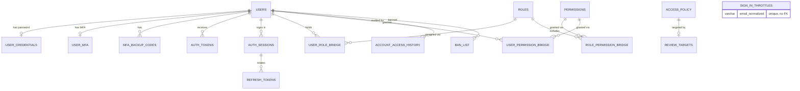
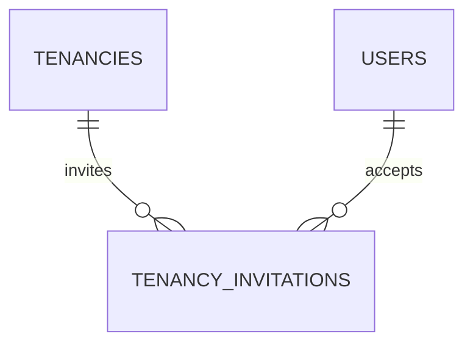

# Schema changes since spec v3 — for updating the diagrams

## Task for the diagram agent

The baseline is spec v3 (`RentTrace_Database_Structure_and_Processes_v3.md`): its ER diagrams in §13 and its 53-table inventory in §18. Apply every change below so the diagrams match the Django models in this repo (`back-end/*/models.py`, `back-end/reviews/models/*.py`).

**The models are the source of truth.** If this document and the code disagree, follow the code.

The schema goes from **53 to 61 tables**:

- 8 new tables;
- 4 renamed tables;
- column changes on 8 existing tables;
- no tables removed.

### Conventions

- Every table has `id BIGINT` identity primary key (not repeated below).
- **Field sets:** draw them as a note or stereotype on the table, not as repeated columns.
  - **M** (mutable): `created_at`, `created_by_id → users`, `updated_at`, `updated_by_id → users`, `row_version`, `is_deleted`, `deleted_at`, `deleted_by_id → users`
  - **E** (append-only event): `created_at`, `created_by_id → users`, `correlation_id UUID`
  - **C** (catalogue): `created_at`, `updated_at`, `is_active`
  - **Operational:** only `created_at` and/or `updated_at`, as listed per table.
- All foreign keys are `ON DELETE RESTRICT`.
- Types are logical PostgreSQL types: `TIMESTAMPTZ` for times, `TEXT` enums with CHECK constraints.
- Cardinality: `||--o{` is one-to-many, `||--o|` is one-to-zero-or-one.

## 1. Renamed tables

| Spec v3 name             | New name                 | Other change                                                              |
| ------------------------ | ------------------------ | ------------------------------------------------------------------------- |
| `user_roles`             | `user_role_bridge`       | Added `is_active BOOLEAN DEFAULT true`                                    |
| `role_permissions`       | `role_permission_bridge` | Added `is_active BOOLEAN DEFAULT true`                                    |
| `user_permission_grants` | `user_permission_bridge` | Added `is_active BOOLEAN DEFAULT true`                                    |
| `auth_session_bindings`  | `auth_sessions`          | Column `provider_session_id` → `session_id`, plus new columns (section 2) |

The relationships of the three bridge tables are unchanged:

- `users ||--o{ user_role_bridge }o--|| roles`
- `roles ||--o{ role_permission_bridge }o--|| permissions`
- `users ||--o{ user_permission_bridge }o--|| permissions`

## 2. Column changes on existing tables

### `users` (M)

| Column                               | Change                                                                    |
| ------------------------------------ | ------------------------------------------------------------------------- |
| `auth_subject UUID`                  | Now **nullable**, still unique. Required only for `auth_method = GOOGLE`. |
| `email_verified_at TIMESTAMPTZ NULL` | **New.** Required for Google accounts.                                    |

### `auth_sessions` (operational: `created_at`, `updated_at`)

Final column list:

| Column            | Type                                  | Note                               |
| ----------------- | ------------------------------------- | ---------------------------------- |
| `user_id`         | FK `users`                            |                                    |
| `session_id`      | UUID unique                           | Renamed from `provider_session_id` |
| `verified_method` | TEXT enum(`GOOGLE`, `EMAIL_PASSWORD`) |                                    |
| `verified_at`     | TIMESTAMPTZ                           |                                    |
| `mfa_verified_at` | TIMESTAMPTZ NULL                      | **New**                            |
| `expires_at`      | TIMESTAMPTZ                           |                                    |
| `revoked_at`      | TIMESTAMPTZ NULL                      |                                    |
| `last_used_at`    | TIMESTAMPTZ                           | **New**                            |
| `device_name`     | VARCHAR(150) NULL                     | **New**                            |
| `user_agent`      | TEXT NULL                             | **New**                            |
| `ip_address`      | INET NULL                             | **New**                            |

### `on_behalf_of` added to three history tables

Add `on_behalf_of_id → users` (nullable) to each, and draw it as a second relationship to `users`:

- `business_change_history`
- `review_status_history`
- `maintenance_status_history`

It records the user a super admin acted for, and must differ from the row's actor.

## 3. New tables

### `user_credentials` (operational: `created_at`, `updated_at`)

Password hash for email/password accounts.

| Column                | Type                                |
| --------------------- | ----------------------------------- |
| `user_id`             | FK `users`, **unique** (one-to-one) |
| `password_hash`       | VARCHAR(255)                        |
| `password_changed_at` | TIMESTAMPTZ                         |

Relationship: `users ||--o| user_credentials`

### `auth_tokens` (operational: `created_at`)

Email verification and password reset links.

| Column       | Type                                              |
| ------------ | ------------------------------------------------- |
| `user_id`    | FK `users`                                        |
| `purpose`    | TEXT enum(`EMAIL_VERIFICATION`, `PASSWORD_RESET`) |
| `token_hash` | CHAR(64) unique (SHA-256)                         |
| `expires_at` | TIMESTAMPTZ                                       |
| `used_at`    | TIMESTAMPTZ NULL                                  |

Relationship: `users ||--o{ auth_tokens`

### `refresh_tokens` (operational: `created_at`)

Our refresh tokens; replaced on every refresh, old rows kept.

| Column       | Type                      |
| ------------ | ------------------------- |
| `session_id` | FK `auth_sessions`        |
| `token_hash` | CHAR(64) unique (SHA-256) |
| `expires_at` | TIMESTAMPTZ               |
| `used_at`    | TIMESTAMPTZ NULL          |

Relationship: `auth_sessions ||--o{ refresh_tokens`. At most one unused token per session.

### `user_mfa` (operational: `created_at`, `updated_at`)

Authenticator-app MFA, required for Admin and super admin.

| Column             | Type                                |
| ------------------ | ----------------------------------- |
| `user_id`          | FK `users`, **unique** (one-to-one) |
| `secret_encrypted` | TEXT                                |
| `confirmed_at`     | TIMESTAMPTZ NULL                    |
| `last_used_step`   | BIGINT NULL                         |

Relationship: `users ||--o| user_mfa`

### `mfa_backup_codes` (operational: `created_at`)

| Column      | Type             |
| ----------- | ---------------- |
| `user_id`   | FK `users`       |
| `code_hash` | VARCHAR(255)     |
| `used_at`   | TIMESTAMPTZ NULL |

Relationship: `users ||--o{ mfa_backup_codes`

### `sign_in_throttles` (operational: `created_at`, `updated_at`)

Failed password attempts per email. **No foreign key:** it's keyed by email, so it also covers emails with no account.

| Column             | Type                |
| ------------------ | ------------------- |
| `email_normalized` | VARCHAR(255) unique |
| `failed_count`     | INTEGER ≥ 0         |
| `last_failed_at`   | TIMESTAMPTZ NULL    |
| `locked_until`     | TIMESTAMPTZ NULL    |

Draw it standalone, near `users`, with no relationship line.

### `ban_list` (M)

Banned identities (before sign-up) and banned accounts.

| Column         | Type                                                   |
| -------------- | ------------------------------------------------------ |
| `ban_type`     | TEXT enum(`EMAIL`, `EMAIL_DOMAIN`, `PHONE`, `ACCOUNT`) |
| `value`        | VARCHAR(255) NULL (for non-`ACCOUNT` types)            |
| `user_id`      | FK `users` NULL (for `ACCOUNT` only)                   |
| `reason`       | TEXT                                                   |
| `expires_at`   | TIMESTAMPTZ NULL                                       |
| `lifted_at`    | TIMESTAMPTZ NULL                                       |
| `lifted_by_id` | FK `users` NULL                                        |
| `lift_reason`  | TEXT NULL                                              |

Relationships:

- `users ||--o{ ban_list` (banned account)
- `users ||--o{ ban_list` (lifted by)
- `created_by_id` from M is who placed the ban

### `tenancy_invitations` (M), in the **tenancies** area, not identity

A landlord inviting a tenant by email, possibly before the tenant has an account.

| Column             | Type                      |
| ------------------ | ------------------------- |
| `tenancy_id`       | FK `tenancies`            |
| `email_normalized` | VARCHAR(255)              |
| `is_primary`       | BOOLEAN DEFAULT false     |
| `token_hash`       | CHAR(64) unique (SHA-256) |
| `expires_at`       | TIMESTAMPTZ               |
| `accepted_at`      | TIMESTAMPTZ NULL          |
| `accepted_by_id`   | FK `users` NULL           |
| `revoked_at`       | TIMESTAMPTZ NULL          |

Relationships:

- `tenancies ||--o{ tenancy_invitations`
- `users ||--o{ tenancy_invitations` (accepted by)

At most one pending invitation per tenancy and email.

## 4. Identity area ER diagram (replacement)

Spec v3 has no identity diagram, so add this one. It shows the tables and relationships; columns are listed in sections 2 and 3.

## 5. Additions to existing diagrams

Add to the §13 property and tenancy diagram:

In the §13 review and maintenance diagrams, if `users` is drawn, add an `on_behalf_of` line from `REVIEW_STATUS_HISTORY` and `MAINTENANCE_STATUS_HISTORY` to `USERS`. Do the same for `BUSINESS_CHANGE_HISTORY` wherever it appears.

## 6. Table inventory (§18) update

Rename entries 5, 6, 7 and 2 as in section 1, then append:

54. `ban_list`
55. `sign_in_throttles`
56. `user_credentials`
57. `auth_tokens`
58. `refresh_tokens`
59. `user_mfa`
60. `mfa_backup_codes`
61. `tenancy_invitations`
